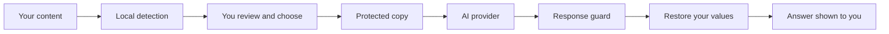

# Obscura

**Use AI without handing over your private data.**

Obscura sits between you and an external AI. It finds personal details, secrets
and sensitive images on your own machine, lets you choose what to hide, shows
you exactly what the AI will receive, and puts your real values back into the
answer afterwards.

Works for **text**, **images** and **PDFs**. Currently talks to **Gemini**; the
interface is ready for more providers.

## How it works



1. **Detect locally.** Rules, a spaCy model and a GLiNER model find names,
   emails, phones, addresses, IDs, cards and secrets. For images and scanned
   PDFs, OCR reads the text first. YOLO finds phones, laptops and TVs, and
   OpenCV finds faces, QR codes and barcodes.
2. **Review.** Every finding is shown. You choose what to hide.
3. **Protect.**
   - Text: values become placeholders such as `<OBSCURA_NAME_001>`.
   - Images: selected areas are filled with solid black (not blurred).
   - PDFs: selected content is permanently removed from the file, and metadata
     and hidden data are stripped.
4. **Send** only the protected copy.
5. **Check and restore.** The response is scanned for leaked originals. If it
   is clean, placeholders are replaced with your real values in the backend.

Secrets (passwords, API keys, tokens, private keys) are **never** sent. They are
removed whether or not you select them.

## Features

| Area | What it does |
| --- | --- |
| Text | Highlighted review, reversible placeholders, one alias per repeated value |
| Images | OCR, faces, QR/barcodes, license plates, phone and laptop screens, metadata stripped |
| PDF | Text and scanned pages, hidden metadata report, real redaction, output re-checked |
| Safety | Secret blocking, response guard, no private values in logs |
| UI | Steps on the left, outputs on the right, light and dark mode, model picker |

## Run it with Docker (easiest)

Requirements: Docker Desktop (or Docker Engine) and about 4 GB of free memory.

```bash
cp backend/.env.example backend/.env      # Windows: copy backend\.env.example backend\.env
# edit backend/.env and set GEMINI_API_KEY

docker compose up --build
```

Open **http://localhost:8080**. The first build downloads the models and takes
several minutes. Check it works:

```bash
python scripts/smoke_test.py
```

## Run it for development (Windows PowerShell)

Backend:

```powershell
cd backend
python -m venv .venv
.venv\Scripts\Activate.ps1

pip install -r requirements.txt
pip uninstall -y opencv-python opencv-python-headless opencv-contrib-python opencv-contrib-python-headless
pip install "opencv-contrib-python-headless>=4.10,<5"
python -m spacy download en_core_web_sm

copy .env.example .env      # then set GEMINI_API_KEY
uvicorn app.main:app --port 8000
```

The `opencv` lines matter: `ultralytics` installs a second OpenCV build that
breaks face and barcode detection.

Frontend (second terminal):

```powershell
cd frontend
npm install
npm run dev
```

Open the address Vite prints (http://localhost:5173).

## Configuration

| Variable | Where | Purpose |
| --- | --- | --- |
| `GEMINI_API_KEY` | `backend/.env` | Your Gemini key (required) |
| `GEMINI_MODEL` | `backend/.env` | Model name your key can use |
| `OBSCURA_CORS_ORIGINS` | `backend/.env` | Browser origins allowed to call the API |
| `OBSCURA_DEBUG` | `backend/.env` | `1` prints debug output. It can contain private data, so keep it `0` |
| `OBSCURA_PDF_OCR_IMAGES` | `backend/.env` | `1` also OCRs images inside text PDFs (slower) |
| `VITE_API_URL` | frontend build | API address. Docker uses `/api`; dev defaults to `http://localhost:8000/api` |

## API

| Method and path | Purpose |
| --- | --- |
| `GET /api/health` | Liveness check |
| `POST /api/privacy/analyze` | Detect sensitive text |
| `POST /api/privacy/prepare` | Create the protected text and a short-lived session |
| `POST /api/chat/send` | Send the protected text, restore the answer |
| `POST /api/image/analyze`, `/prepare`, `/send` | Same flow for images |
| `POST /api/pdf/analyze`, `/prepare`, `/send` | Same flow for PDFs |

Interactive docs are at `/docs` when you run the backend directly.

## Tests

```bash
cd backend
pytest -v                          # unit and API tests
python ../scripts/smoke_test.py    # end-to-end check on a running instance
```

The pytest suite covers detection patterns, fusion, the protect-and-restore
round trip, secret blocking, the response guard, image redaction and PDF
redaction. The GitLab pipeline runs it on every push.

For responsive checks, open the app in browser DevTools device mode at about
375, 768 and 1280 px wide and test all three tabs in light and dark mode.

## Deploy

The pipeline in `.gitlab-ci.yml` runs tests, builds both images, pushes them to
the GitLab registry and deploys to your server on a manual click.

**You need:** a Linux server with 4 GB RAM or more (a small VPS is fine), Docker
with the Compose plugin, and a domain name pointing at the server.

Why a server and not a free tier: the backend loads PyTorch, two language
models, an OCR engine and an object detector. Free tiers with 512 MB of memory
cannot run it.

### One-time server setup

```bash
sudo mkdir -p /opt/obscura && sudo chown $USER /opt/obscura
cd /opt/obscura

# Log in to the GitLab registry with a deploy token (scope: read_registry)
docker login registry.gitlab.com

# Backend secrets
cat > backend.env <<EOF
GEMINI_API_KEY=your_key
GEMINI_MODEL=gemini-3.6-flash
OBSCURA_DEBUG=0
EOF

# Create a login password hash
docker run --rm caddy caddy hash-password --plaintext 'choose-a-strong-password'
```

Create `/opt/obscura/.env` (keep the hash in single quotes):

```
DOMAIN=obscura.example.com
IMAGE_PREFIX=registry.gitlab.com/your-group/your-project
APP_USER=admin
APP_PASSWORD_HASH='$2a$14$...paste the hash here...'
```

### GitLab setup

1. Create a project and push the code (`git remote add origin ...`, then
   `git push -u origin main`).
2. In **Settings > CI/CD > Variables** add `SSH_HOST`, `SSH_USER` and
   `SSH_PRIVATE_KEY` (a key whose public half is in the server's
   `~/.ssh/authorized_keys`).
3. Push to the default branch. When the build finishes, press **Run** on the
   `deploy:production` job.
4. Open `https://your-domain` and confirm with
   `python scripts/smoke_test.py --base https://your-domain --auth admin:password`.

Caddy gets and renews the HTTPS certificate automatically.

## Security model and limits

- **Detection is not perfect.** It can miss things and can flag harmless text.
  Always check the "What the AI receives" output before sending.
- **Not detected yet:** physical documents with no readable text, faces that are
  small, masked or turned away, and secrets in unusual formats.
- **Sessions live in memory** for 15 minutes and are deleted after use. The
  backend runs a single worker for this reason. Restarting it clears them.
- **No built-in accounts or rate limits.** A public deployment must sit behind
  the login shown above, or anyone can spend your Gemini quota.
- **Gemini receives the protected copy.** Check Google's terms for how API data
  is handled before using sensitive material.
- **Logs** never contain original values unless `OBSCURA_DEBUG=1`.

## Project structure

```
backend/
  app/
    privacy/        detectors, fusion, pseudonymizer, vault, response guard
      image/        OCR, faces, devices, redaction
      pdf/          PDF analysis and redaction
    routes/         privacy, chat, image, pdf
    ai/gemini.py    provider call
  tests/
frontend/
  src/              React app (Text, Images, PDF)
docker-compose.yml          local run
docker-compose.prod.yml     server run
.gitlab-ci.yml              test, build, deploy
scripts/smoke_test.py
```

## Roadmap

- More providers (ChatGPT, Claude) behind one interface
- Multi-turn chat with a shared alias map
- Document-shape detection for ID cards and paper forms
- Accounts and rate limits
